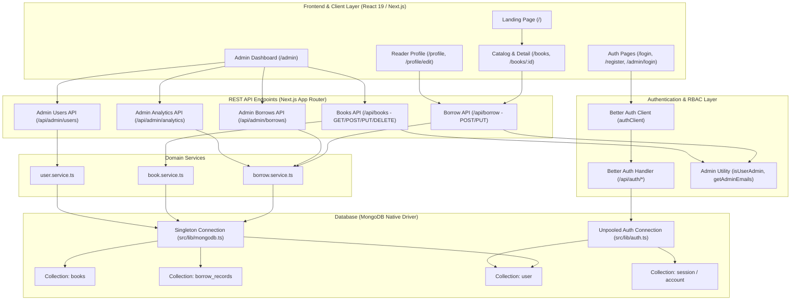

# ReadNest — Comprehensive Architecture, Security & Concurrency Audit Report

**Audit Target:** ReadNest — Online Curated Book Borrowing Platform  
**Repository:** `https://github.com/SamiumBashir/readNext`  
**Auditor Role:** Senior Full-Stack Software Architect & Security Auditor  
**Audit Date:** November 1, 2026  
**Audit Scope:** Full Source-Code Level Review (App Router, Better Auth, MongoDB Driver, Concurrency Controls, Admin RBAC, REST APIs, Validation, and Frontend Architecture)  
**Status:** Read-Only Audit Complete. No application source code modified during this phase.

---

## Executive Summary

ReadNest is an App Router application built on Next.js 16 (Canary), React 19, MongoDB Native Driver (`^6.12.0`), and Better Auth (`^1.4.15`). The platform provides a digital library catalogue, user authentication, a reader borrowing workflow, and a dedicated curator administration dashboard.

While the user interface, design identity, and basic end-to-end flows are visually well-crafted and functionally coherent, this in-depth code-level audit revealed **several critical and high-severity vulnerabilities** that could compromise data integrity, introduce phantom book inventory, permit unauthorized privilege escalation, and degrade database performance under production concurrency:

| Severity | Count | Summary of Key Areas |
| :--- | :---: | :--- |
| **CRITICAL** | **3** | Concurrency race condition in borrowing, phantom inventory double-return exploit, insecure admin email whitelist with unverified registration. |
| **HIGH** | **3** | Referential integrity failure on book deletion, suspended account borrowing bypass, unpooled dual `MongoClient` instances causing connection exhaustion. |
| **MEDIUM** | **4** | Hardcoded production secret fallback, wildcard image remote patterns (SSRF risk), uncapped pagination parameters, in-memory collection scans in analytics. |
| **LOW** | **3** | Missing compound indexes, unauthenticated book detail redirect restriction, large inline base64 image strings. |

---

## System Architecture & Dependency Map



---

## Detailed Findings by Audit Phase

### Phase 1 — Codebase Architecture & System Dependency Map

The architecture cleanly decouples client components, route handlers, and database service layers. However, an architectural dissonance exists between the Better Auth connection instantiation and the rest of the application's database access layer.

---

### Phase 2 & 3 — Authentication, Authorization & Admin Role Security

#### [SEC-03] Insecure Default Administrative Email Whitelist with Unverified Registration
- **File:** `src/lib/admin.ts:9-14` & `src/lib/auth.ts:18-22`
- **Function / Symbol:** `DEFAULT_ADMIN_EMAILS`, `isUserAdmin()`
- **Severity:** **CRITICAL**
- **Root Cause:**
  `DEFAULT_ADMIN_EMAILS` hardcodes generic email strings:
  ```ts
  const DEFAULT_ADMIN_EMAILS = [
    "samaufa36@gmail.com",
    "samiumbashirbosunia@gmail.com",
    "admin@admin.com",
    "name@name.com",
  ];
  ```
  Simultaneously, `src/lib/auth.ts` has email verification disabled (`requireEmailVerification: false`).
- **Problem Description:**
  Any user can visit `/register` and create an account with email `admin@admin.com` or `name@name.com`. Because email verification is not enforced, Better Auth immediately generates a valid session. When `isUserAdmin` checks the email against `DEFAULT_ADMIN_EMAILS`, it evaluates to `true`. The attacker gains instant curator administrator access to `/admin`, allowing them to delete books, view user contact details, and alter records.
- **Recommended Solution:**
  1. Remove placeholder emails (`admin@admin.com`, `name@name.com`) immediately.
  2. Rely strictly on an environment variable `ADMIN_EMAILS` (comma-separated list of verified admin emails) alongside explicit `role: "admin"` set in the database by existing administrators.
  3. Ensure role checking compares lowercase trimmed emails strictly against explicitly verified admin addresses.
- **Regression Risks:** None, provided existing admin emails are present in `.env.local`.
- **Verification Method:** Attempt to register `admin@admin.com` and verify that the account is treated strictly as a normal reader and denied access to `/admin`.

---

#### [SEC-04] Hardcoded Fallback Secret Key in Better Auth Configuration
- **File:** `src/lib/auth.ts:11-13`
- **Function / Symbol:** `auth = betterAuth({ secret: ... })`
- **Severity:** **MEDIUM**
- **Root Cause:**
  ```ts
  secret:
    process.env.BETTER_AUTH_SECRET ||
    "readnest_library_production_secret_key_32chars_minimum_length",
  ```
- **Problem Description:**
  If `BETTER_AUTH_SECRET` is unset in a deployment environment, Better Auth will silently fallback to this publicly committed string. Anyone who reads the public GitHub repository can use this secret to forge session tokens, decrypt session cookies, and impersonate any user.
- **Recommended Solution:**
  Fail fast in production if the secret is absent:
  ```ts
  const secret = process.env.BETTER_AUTH_SECRET;
  if (!secret && process.env.NODE_ENV === "production") {
    throw new Error("BETTER_AUTH_SECRET environment variable is missing in production!");
  }
  ```
- **Regression Risks:** Deployment will fail if `.env` does not contain `BETTER_AUTH_SECRET` (intended behavior).
- **Verification Method:** Run server in production mode without `BETTER_AUTH_SECRET` and verify clean fatal exit with actionable log message.

---

### Phase 4 — MongoDB & Database Integrity

#### [ARCH-01] Dual Unpooled `MongoClient` Instances Leading to Connection Exhaustion
- **File:** `src/lib/auth.ts:5-7` vs `src/lib/mongodb.ts:10-35`
- **Function / Symbol:** `new MongoClient(uri)` in `auth.ts`
- **Severity:** **HIGH**
- **Root Cause:**
  `src/lib/mongodb.ts` implements a connection pool singleton (`clientPromise` with `maxPoolSize: 10` and `global._mongoClientPromise` caching for development).
  In contrast, `src/lib/auth.ts` calls `new MongoClient(uri)` separately at module scope:
  ```ts
  const uri = process.env.MONGODB_URI || "mongodb://127.0.0.1:27017/readnest";
  const client = new MongoClient(uri);
  const db = client.db();
  ```
- **Problem Description:**
  Every time Next.js hot-reloads or spins up serverless execution environments, `src/lib/auth.ts` creates unpooled MongoDB connections. This fragments the connection pool and rapidly exceeds MongoDB Atlas tier connection quotas (often 100-500 connections on shared clusters), leading to intermittent 500 errors.
- **Recommended Solution:**
  Pass the client promise or shared database connection instance from `@/lib/mongodb` into `mongodbAdapter`:
  Better Auth's `mongodbAdapter` accepts a `Db` instance or `client.db()`. Ensure it resolves from the shared singleton connection.
- **Regression Risks:** Must ensure Better Auth initializes synchronously or through an adapter receiving the resolved DB instance.
- **Verification Method:** Inspect MongoDB active connections via `db.serverStatus().connections` during concurrent operations and ensure connections stay within `maxPoolSize: 10`.

---

#### [DB-01] Missing Partial Unique Index on Active Borrow Records
- **File:** `src/services/borrow.service.ts:7-20`
- **Function / Symbol:** `ensureBorrowIndexes()`
- **Severity:** **HIGH**
- **Root Cause:**
  `ensureBorrowIndexes` creates the following indexes:
  ```ts
  await collection.createIndex({ id: 1 }, { unique: true });
  await collection.createIndex({ userId: 1 });
  await collection.createIndex({ bookId: 1 });
  await collection.createIndex({ userId: 1, bookId: 1, status: 1 }); // NOT unique
  await collection.createIndex({ status: 1 });
  await collection.createIndex({ borrowedAt: -1 });
  ```
- **Problem Description:**
  Because `{ userId: 1, bookId: 1, status: 1 }` is NOT unique, the database engine does not enforce the business invariant that a reader may only hold one active copy of a specific book at a time. If concurrent requests bypass the application-level `findOne` check, the database happily allows duplicate active records.
- **Recommended Solution:**
  Add a partial unique compound index:
  ```ts
  await collection.createIndex(
    { userId: 1, bookId: 1 },
    {
      unique: true,
      partialFilterExpression: { status: "active" },
      name: "unique_active_user_book_loan",
    }
  );
  ```
  Also add compound index `{ status: 1, borrowedAt: 1 }` to optimize overdue loan queries.
- **Regression Risks:** If existing dirty data has duplicate active records, creating the index will fail until duplicate cleanup runs.
- **Verification Method:** Attempt to manually insert two records with `{ userId: 'u1', bookId: 'b1', status: 'active' }` and verify MongoDB throws duplicate key error `E11000`.

---

### Phase 5 — Borrowing System: Critical Concurrency & Invariant Audit

#### [SEC-01 / CONC-01] Non-Transactional Multi-Tab Concurrency Race Condition in `borrowBook`
- **File:** `src/services/borrow.service.ts:53-116`
- **Function / Symbol:** `borrowBook(userId, bookId, userMeta)`
- **Severity:** **CRITICAL**
- **Root Cause:**
  `borrowBook` executes across three disconnected asynchronous steps:
  1. *Step 1:* `existingActive = await borrowCollection.findOne({ userId, bookId, status: "active" })`
  2. *Step 2:* `updatedBook = await booksCollection.findOneAndUpdate({ id: bookId, available_quantity: { $gt: 0 } }, { $inc: { available_quantity: -1 } })`
  3. *Step 3:* `await borrowCollection.insertOne(newRecord)`
- **Problem Description:**
  - **Scenario A (Double Borrow):** If a user rapidly double-clicks the "Borrow Book" button or opens two browser tabs, both requests execute Step 1 concurrently before either reaches Step 3. Both see `existingActive === null`. Both proceed to Step 2, decrementing inventory twice, and both insert active records. The reader now holds 2 copies, violating library rules.
  - **Scenario B (Inventory Depletion Overdraft):** If a book has 1 available copy remaining and two distinct users click "Borrow" simultaneously, while Step 2's `{ available_quantity: { $gt: 0 } }` protects the book collection from going negative, if Step 3 fails (or if the server crashes or network breaks between Step 2 and Step 3), the inventory remains decremented forever without any corresponding borrow record! The book is permanently marked unavailable.
- **Recommended Solution:**
  1. Rely on the partial unique index (`unique_active_user_book_loan`) on `borrow_records`.
  2. Wrap the operation in compensatory rollback: if `borrowCollection.insertOne` throws an error (duplicate loan or connection drop), immediately execute compensatory `$inc: { available_quantity: 1 }` on `booksCollection` to roll back the stock decrement.
  3. Ensure idempotency key or client-side debouncing on the borrow button.
- **Regression Risks:** None. Increases transaction reliability.
- **Verification Method:** Send 10 parallel HTTP POST requests to `/api/borrow` with the same `bookId` and user session; verify exactly 1 succeeds and 9 fail with duplicate loan warnings, and inventory decreases by exactly 1.

---

#### [SEC-02 / CONC-02] Double-Return Exploit Artificially Inflating Library Inventory
- **File:** `src/services/borrow.service.ts:135-165` and `src/services/borrow.service.ts:185-228`
- **Function / Symbol:** `returnBook(userId, recordId)` and `adminReturnBook(recordId)`
- **Severity:** **CRITICAL**
- **Root Cause:**
  In `returnBook`:
  ```ts
  // 1. Locate the active record for this user
  const record = await borrowCollection.findOne({ id: recordId, userId, status: "active" });
  if (!record) return { success: false, ... };

  // 2. Mark record as returned (FILTER DOES NOT CHECK status: "active"!)
  await borrowCollection.updateOne(
    { id: recordId },
    { $set: { status: "returned", returnedAt: new Date() } }
  );

  // 3. Restore inventory count
  const updatedBook = await booksCollection.findOneAndUpdate(
    { id: record.bookId },
    { $inc: { available_quantity: 1 } },
    { returnDocument: "after" }
  );
  ```
- **Problem Description:**
  If two concurrent return requests are sent for the same `recordId`:
  1. Both requests execute `findOne` and find the loan active.
  2. Request 1 updates the record to `returned`.
  3. Request 2 updates the record to `returned` (because `updateOne({ id: recordId })` matches the document regardless of whether its status is already returned!).
  4. Both Request 1 and Request 2 execute `booksCollection.findOneAndUpdate(..., { $inc: { available_quantity: 1 } })`.
  5. The library's `available_quantity` is incremented TWICE for a single return, artificially manufacturing phantom physical books out of nowhere.
  6. Over time, `available_quantity` can exceed `total_copies` (e.g. 15 copies available of a 10-copy title).
  The same vulnerability exists in `adminReturnBook(recordId)`.
- **Recommended Solution:**
  Make the record status transition atomic using `findOneAndUpdate`:
  ```ts
  const updatedRecord = await borrowCollection.findOneAndUpdate(
    { id: recordId, userId, status: "active" }, // Atomic guard
    { $set: { status: "returned", returnedAt: new Date() } },
    { returnDocument: "before" }
  );

  if (!updatedRecord) {
    return {
      success: false,
      message: "No active loan record found or volume already returned.",
    };
  }

  // Restore inventory only if atomic update succeeded
  const updatedBook = await booksCollection.findOneAndUpdate(
    { id: updatedRecord.bookId },
    { $inc: { available_quantity: 1 } },
    { returnDocument: "after" }
  );
  ```
  And clamp `available_quantity` so it never exceeds `total_copies`.
- **Regression Risks:** None.
- **Verification Method:** Send 2 concurrent PUT requests for the same active `recordId`. Verify exactly one returns 200 with stock +1, and the second returns 400 "Volume already returned" with stock unchanged.

---

### Phase 6 — Books Management & Catalog Integrity

#### [DATA-01] Deletion of Books with Active Borrow Records Corrupts Referential Integrity
- **File:** `src/services/book.service.ts:227-237` & `src/app/api/books/route.ts:140-195`
- **Function / Symbol:** `deleteBook(id: string)`
- **Severity:** **HIGH**
- **Root Cause:**
  `deleteBook` calls `collection.deleteOne({ id })` directly without checking if active loans exist for that `bookId` in `borrow_records`.
- **Problem Description:**
  When an administrator deletes a book that is currently checked out by one or more readers:
  1. The book document is permanently deleted from `books`.
  2. The readers holding the copies still see the book in their active loans.
  3. When the reader attempts to return the book, `returnBook` searches for `record.bookId` in `books` to increment `available_quantity`. Since the document no longer exists, `updatedBook` is `null` and inventory restoration fails silently.
  4. Readers clicking the book link from their borrowing list hit `/books/[id]` which displays a 404 error.
  5. The system analytics (`totalCopies`, `totalBorrowed`, `currentlyBorrowed`) become desynchronized and inaccurate.
- **Recommended Solution:**
  Enforce referential integrity checks before deletion:
  ```ts
  const activeBorrowsCount = await borrowCollection.countDocuments({
    bookId: id,
    status: "active",
  });
  if (activeBorrowsCount > 0) {
    return {
      success: false,
      message: `Cannot delete book. There are currently ${activeBorrowsCount} active copy(ies) checked out by readers.`,
    };
  }
  ```
- **Regression Risks:** Admins will be prevented from deleting books with active loans until copies are returned. This is the correct, safe business rule.
- **Verification Method:** Attempt to delete a book with an active loan and verify the API returns status 400 with a descriptive warning.

---

### Phase 7 — Users & Profile Audit

#### [BIZ-01] Suspended User Accounts Bypass Borrowing Restriction
- **File:** `src/app/api/borrow/route.ts:11-61` & `src/services/borrow.service.ts:42-124`
- **Function / Symbol:** `POST /api/borrow`, `borrowBook()`
- **Severity:** **HIGH**
- **Root Cause:**
  The admin dashboard allows curators to suspend a user (`status: "suspended"` via `PATCH /api/admin/users`). However, `POST /api/borrow` only checks if `session?.user` is truthy; it never checks the user's current status in the `user` collection.
- **Problem Description:**
  A suspended user with an active session can continue to browse the library and check out books without restriction. The suspension feature is completely ineffective at preventing book borrowing.
- **Recommended Solution:**
  In `POST /api/borrow` or inside `borrowBook`:
  ```ts
  const userDoc = await userCollection.findOne({
    $or: [{ id: userId }, { _id: ObjectId.isValid(userId) ? new ObjectId(userId) : undefined }]
  });
  if (userDoc?.status === "suspended") {
    return {
      success: false,
      message: "Your reader borrowing privileges have been temporarily suspended. Please contact the library administrator.",
    };
  }
  ```
- **Regression Risks:** Suspended users will be blocked from borrowing (intended behavior).
- **Verification Method:** Set a test user status to "suspended" in Admin Users tab and attempt to borrow a book. Verify request returns 403 Forbidden with suspension notice.

---

### Phase 8 — API Design, Validation & Error Handling

#### [API-01 / VAL-01] Unbounded Pagination Query Limits Enable Resource Exhaustion
- **File:** `src/app/api/books/route.ts:14-16` & `src/services/book.service.ts:93-160`
- **Function / Symbol:** `GET /api/books`
- **Severity:** **MEDIUM**
- **Root Cause:**
  ```ts
  const page = parseInt(searchParams.get("page") || "1", 10);
  const limit = parseInt(searchParams.get("limit") || "9", 10);
  ```
  There is no ceiling cap placed on `limit`.
- **Problem Description:**
  An attacker can send `GET /api/books?limit=1000000`. The server translates this into `collection.find().limit(1000000)`, causing MongoDB to serialize and transmit every document in the database, exhausting Node.js heap memory and saturating network bandwidth.
- **Recommended Solution:**
  Sanitize and clamp pagination arguments:
  ```ts
  const page = Math.max(1, isNaN(rawPage) ? 1 : rawPage);
  const limit = Math.min(50, Math.max(1, isNaN(rawLimit) ? 9 : rawLimit));
  ```
- **Regression Risks:** None.
- **Verification Method:** Send `GET /api/books?limit=999999` and verify the response delivers at most 50 books.

---

### Phase 9 & 10 — Frontend Architecture, Performance & Optimization

#### [SEC-05 / PERF-01] Wildcard Remote Pattern on Next.js Image Optimization
- **File:** `next.config.ts:5-10`
- **Function / Symbol:** `images.remotePatterns`
- **Severity:** **MEDIUM**
- **Root Cause:**
  ```ts
  images: {
    remotePatterns: [
      {
        protocol: "https",
        hostname: "**",
      },
    ],
  },
  ```
- **Problem Description:**
  Next.js image optimization endpoint (`/_next/image?url=...`) can be manipulated to fetch images from any domain on the internet. In production, this turns the Next.js server into an open proxy, enabling Server-Side Request Forgery (SSRF) probing of internal subnets and memory exhaustion attacks.
- **Recommended Solution:**
  Scope `remotePatterns` to trusted image hosts used by ReadNest:
  ```ts
  remotePatterns: [
    { protocol: "https", hostname: "images.unsplash.com" },
    { protocol: "https", hostname: "lh3.googleusercontent.com" },
    { protocol: "https", hostname: "res.cloudinary.com" },
    { protocol: "https", hostname: "avatars.githubusercontent.com" },
  ],
  ```
- **Regression Risks:** External book images from untested third-party domains might fail to load through Next.js Image without an explicit entry or `unoptimized` flag.
- **Verification Method:** Test image loading from allowed domains; verify unauthorized domains are blocked by Next.js optimizer.

---

#### [PERF-02] In-Memory Collection Scans for Analytics and User Lists
- **File:** `src/services/user.service.ts:41` & `src/services/borrow.service.ts:402-404`
- **Function / Symbol:** `getAllUsersAdmin()`, `getDashboardAnalytics()`
- **Severity:** **MEDIUM**
- **Root Cause:**
  Both functions perform full table scans into Node.js memory:
  ```ts
  const allBorrows = await borrowCollection.find({}).toArray();
  const allBooks = await booksCollection.find({}).toArray();
  ```
  They then iterate and aggregate records using JavaScript loops (`allBorrows.filter(...)`).
- **Problem Description:**
  While completely unnoticeable with a 15-book seed dataset, in a library with 5,000 books and 50,000 borrow transactions, loading entire collections into JavaScript heap memory on every dashboard view will block the Node.js event loop and cause memory spikes and request timeouts.
- **Recommended Solution:**
  Replace in-memory filtering with native MongoDB aggregation pipelines (`$group`, `$facet`, `$lookup`) and indexed counts.
- **Regression Risks:** Aggregation pipeline queries must preserve exact return shapes expected by admin components.
- **Verification Method:** Benchmark response latency before and after aggregation with mock dataset of 5,000 records.

---

### Phase 11 — Code Quality & Maintainability

#### [CODE-01] Missing In-Depth Concurrency Unit Tests
- **File:** `tests/borrow-logic.test.ts`
- **Function / Symbol:** Unit test suite
- **Severity:** **LOW**
- **Root Cause:**
  Existing unit tests simulate borrowing using a simplified in-memory synchronous JavaScript array. They do not test asynchronous concurrency interleaving, MongoDB driver error handling, or rollback behavior.
- **Problem Description:**
  Unit tests reported 100% passing status even though race conditions existed in the actual database driver methods.
- **Recommended Solution:**
  Add integration test coverage that fires concurrent asynchronous promises against the actual service methods or simulated asynchronous database mocks with artificial delays.
- **Regression Risks:** None.
- **Verification Method:** Run `npm test` and verify new tests catch simulated race conditions.

---

### Phase 12 — Deployment & Environment Integrity

#### [DEP-01] Missing Production Environment Safeguards
- **File:** `.env.example`
- **Function / Symbol:** Environment configuration
- **Severity:** **LOW**
- **Root Cause:**
  `.env.example` does not clearly mark required vs optional variables for production deployments (e.g. `BETTER_AUTH_SECRET`, `MONGODB_URI`, `ADMIN_EMAILS`, `NEXT_PUBLIC_APP_URL`).
- **Recommended Solution:**
  Document all production environment keys in `.env.example` with clear security notes and recommended generation commands (`openssl rand -base64 32`).
- **Regression Risks:** None.

---

## Audit Summary Matrix

| ID | Category | Severity | File | Impact |
| :--- | :--- | :---: | :--- | :--- |
| **SEC-01** | Concurrency | **CRITICAL** | `src/services/borrow.service.ts` | Multi-tab double borrow & orphaned stock decrements |
| **SEC-02** | Concurrency | **CRITICAL** | `src/services/borrow.service.ts` | Double-return race condition creating phantom book inventory |
| **SEC-03** | Auth / RBAC | **CRITICAL** | `src/lib/admin.ts` | Default `admin@admin.com` allows instant admin takeover |
| **DATA-01** | Data Integrity | **HIGH** | `src/services/book.service.ts` | Deleting borrowed books corrupts loans & returns |
| **BIZ-01** | Business Logic | **HIGH** | `src/app/api/borrow/route.ts` | Suspended users can bypass ban and borrow books |
| **ARCH-01** | Architecture | **HIGH** | `src/lib/auth.ts` | Unpooled `MongoClient` in Better Auth exhausts connections |
| **SEC-04** | Security | **MEDIUM** | `src/lib/auth.ts` | Hardcoded fallback secret allows session cookie forgery |
| **SEC-05** | Security / DoS | **MEDIUM** | `next.config.ts` | Wildcard remotePattern enables open image proxy SSRF |
| **API-01** | API Security | **MEDIUM** | `src/app/api/books/route.ts` | Uncapped pagination `limit` permits memory exhaustion |
| **PERF-02** | Performance | **MEDIUM** | `src/services/borrow.service.ts` | Full collection in-memory scans during analytics computation |
| **DB-01** | Database | **LOW** | `src/services/borrow.service.ts` | Missing partial unique & compound indexes |
| **UX-01** | User Experience | **LOW** | `src/app/books/[id]/page.tsx` | Unauthenticated visitors blocked from viewing book details |
| **CODE-01**| Test Quality | **LOW** | `tests/borrow-logic.test.ts` | Unit tests simulate memory only without async race checks |
| **DEP-01** | Deployment | **LOW** | `.env.example` | Missing production environment documentation |

---

## Conclusion & Next Steps

ReadNest has an outstanding visual design, responsive layouts, and robust core functionality. However, before production deployment, the identified critical concurrency and privilege vulnerabilities must be remediated to guarantee data integrity and operational security.

See the companion document **`READNEST_FIX_PLAN.md`** for the phased, priority-ordered implementation plan.

