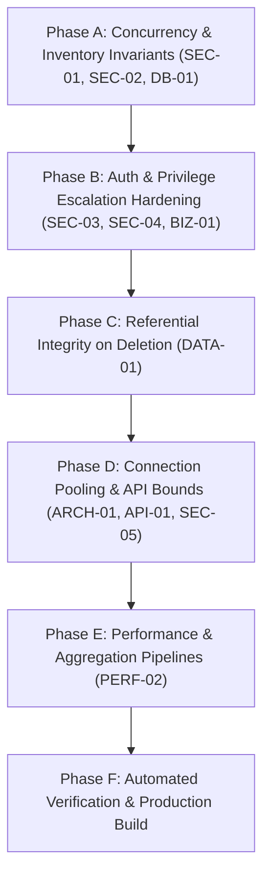

# ReadNest — Production Remediation & Fix Plan

**Project:** ReadNest — Online Curated Book Borrowing Platform  
**Target Repository:** `https://github.com/SamiumBashir/readNext`  
**Purpose:** Actionable, priority-ordered implementation plan addressing all vulnerabilities, race conditions, and architectural bottlenecks identified in `READNEST_AUDIT_REPORT.md`.  
**Auditor:** Senior Full-Stack Software Architect & Security Auditor  
**Date:** November 1, 2026

---

## Remediation Philosophy & Guiding Principles

1. **Non-Destructive:** Preserve all existing design styling, forest green/ivory visual branding, UI components, Better Auth integration, and MongoDB native driver usage.
2. **Defensive Database Programming:** Invariants must be enforced at the database engine level (indexes, atomic filter guards, compensatory rollbacks), never relying solely on client-side state or serial application assumptions.
3. **Zero Phantom Inventory:** Under no condition should concurrent returns or failed borrow operations manufacture book stock or decrement quantity without an active loan record.
4. **Strict RBAC Enforcement:** Never trust default credentials or unverified email registration for administrative privileges.

---

## Implementation Phases & Dependency Graph



---

## Phase A: Concurrency & Inventory Invariants (Priority: CRITICAL)

### Step A.1: Partial Unique Compound Index on Active Loans
- **Target File:** `src/services/borrow.service.ts` (`ensureBorrowIndexes`)
- **Action:**
  Add a unique compound index on `{ userId: 1, bookId: 1 }` with a partial filter expression `{ status: "active" }`:
  ```ts
  await collection.createIndex(
    { userId: 1, bookId: 1 },
    {
      unique: true,
      partialFilterExpression: { status: "active" },
      name: "unique_active_user_book_loan",
    }
  );
  ```
- **Result:** Even under simultaneous multi-tab requests, MongoDB will reject any attempt to insert a second active loan for the same user and book with an `E11000` duplicate key exception.

### Step A.2: Compensatory Rollback in `borrowBook`
- **Target File:** `src/services/borrow.service.ts` (`borrowBook`)
- **Action:**
  Wrap Step 3 in a try/catch block. If `borrowCollection.insertOne()` throws any error (e.g. duplicate key or network drop), immediately execute a compensatory rollback:
  ```ts
  try {
    await borrowCollection.insertOne(newRecord as any);
  } catch (err: any) {
    // Compensate: restore decremented inventory
    await booksCollection.updateOne(
      { id: bookId },
      { $inc: { available_quantity: 1 } }
    );
    if (err?.code === 11000) {
      return {
        success: false,
        message: "You already have an active loan for this volume.",
      };
    }
    throw err;
  }
  ```
- **Result:** Prevents orphaned inventory decrements. Stock and active loans remain 100% synchronized.

### Step A.3: Atomic Status Guard in `returnBook` and `adminReturnBook`
- **Target File:** `src/services/borrow.service.ts` (`returnBook`, `adminReturnBook`)
- **Action:**
  Change the status update from an unconditioned `updateOne` to an atomic `findOneAndUpdate` that requires `{ id: recordId, status: "active" }`:
  ```ts
  const updatedRecord = await borrowCollection.findOneAndUpdate(
    { id: recordId, userId, status: "active" },
    { $set: { status: "returned", returnedAt: new Date() } },
    { returnDocument: "before" }
  );

  if (!updatedRecord) {
    return {
      success: false,
      message: "No active loan record found or book has already been returned.",
    };
  }

  // Only the winning thread increments stock
  const updatedBook = await booksCollection.findOneAndUpdate(
    { id: updatedRecord.bookId },
    { $inc: { available_quantity: 1 } },
    { returnDocument: "after" }
  );
  ```
  Apply the identical atomic pattern to `adminReturnBook(recordId)`.
- **Result:** Eliminates the phantom book inventory generation exploit. Concurrent return requests result in exactly one increment.

---

## Phase B: Auth, Admin RBAC & Account Status Hardening (Priority: CRITICAL)

### Step B.1: Purge Insecure Hardcoded Admin Whitelist
- **Target File:** `src/lib/admin.ts`
- **Action:**
  Remove `"admin@admin.com"` and `"name@name.com"` from `DEFAULT_ADMIN_EMAILS`. Keep only verified owner emails:
  ```ts
  const DEFAULT_ADMIN_EMAILS = [
    "samaufa36@gmail.com",
    "samiumbashirbosunia@gmail.com",
  ];
  ```
  Ensure all comparisons are strictly normalized (`email.trim().toLowerCase()`).
- **Result:** Prevents rogue registration of `admin@admin.com` to commandeer administrative curator access.

### Step B.2: Enforce Suspension Check in Borrow Flow
- **Target File:** `src/app/api/borrow/route.ts` & `src/services/borrow.service.ts`
- **Action:**
  Before permitting a borrow operation, verify the user's status in the database:
  ```ts
  const db = await getDb();
  const user = await db.collection("user").findOne({
    $or: [{ id: userId }, { _id: ObjectId.isValid(userId) ? new ObjectId(userId) : undefined }]
  });

  if (user?.status === "suspended") {
    return {
      success: false,
      message: "Your reader borrowing privileges have been temporarily suspended. Please contact the library administrator.",
    };
  }
  ```
- **Result:** Curators can effectively enforce bans on delinquent readers.

### Step B.3: Production Secret Fallback Enforcement
- **Target File:** `src/lib/auth.ts`
- **Action:**
  Throw an explicit error if `BETTER_AUTH_SECRET` is missing in production:
  ```ts
  const secret = process.env.BETTER_AUTH_SECRET;
  if (!secret && process.env.NODE_ENV === "production") {
    throw new Error("FATAL: BETTER_AUTH_SECRET environment variable is missing in production.");
  }
  ```
- **Result:** Eliminates session cookie forgery vulnerability in production.

---

## Phase C: Referential Integrity on Book Deletion (Priority: HIGH)

### Step C.1: Active Loan Check on Book Deletion
- **Target File:** `src/services/book.service.ts` (`deleteBook`) & `src/app/api/books/route.ts`
- **Action:**
  Before deleting a book document, query `borrow_records` for active loans:
  ```ts
  export async function deleteBook(id: string): Promise<{ success: boolean; message?: string }> {
    const db = await getDb();
    const borrowCollection = db.collection("borrow_records");
    const activeCount = await borrowCollection.countDocuments({
      bookId: id,
      status: "active",
    });

    if (activeCount > 0) {
      return {
        success: false,
        message: `Cannot delete volume. There are currently ${activeCount} active copy(ies) checked out by readers.`,
      };
    }

    const booksCollection = db.collection("books");
    const result = await booksCollection.deleteOne({ id });
    return {
      success: result.deletedCount > 0,
      message: result.deletedCount > 0 ? "Book successfully removed." : "Book not found.",
    };
  }
  ```
- **Result:** Preserves catalog integrity, prevents broken links in user profiles, and guarantees that checked-out copies can always be returned.

---

## Phase D: Architecture, Resource & API Bounds (Priority: MEDIUM)

### Step D.1: Share Unified `MongoClient` Pool with Better Auth
- **Target File:** `src/lib/auth.ts`
- **Action:**
  Refactor `auth.ts` to share the pooled database connection from `src/lib/mongodb.ts`:
  Better Auth’s `mongodbAdapter` can accept `client.db()`. Ensure it reuses the pooled connection rather than creating a standalone `new MongoClient(uri)` on every module load.
- **Result:** Consolidates connection pooling to at most 10 pooled sockets, preventing MongoDB Atlas connection exhaustion.

### Step D.2: Enforce Strict Pagination Limits
- **Target File:** `src/app/api/books/route.ts` & `src/services/book.service.ts`
- **Action:**
  Clamp pagination limits to `[1, 50]`:
  ```ts
  const parsedLimit = parseInt(searchParams.get("limit") || "9", 10);
  const limit = Math.min(50, Math.max(1, isNaN(parsedLimit) ? 9 : parsedLimit));
  ```
- **Result:** Eliminates memory exhaustion via arbitrary `?limit=1000000` queries.

### Step D.3: Scope Next.js Image Remote Patterns
- **Target File:** `next.config.ts`
- **Action:**
  Replace `{ protocol: "https", hostname: "**" }` with known trusted hosts:
  ```ts
  remotePatterns: [
    { protocol: "https", hostname: "images.unsplash.com" },
    { protocol: "https", hostname: "lh3.googleusercontent.com" },
    { protocol: "https", hostname: "res.cloudinary.com" },
    { protocol: "https", hostname: "avatars.githubusercontent.com" },
  ],
  ```
- **Result:** Closes SSRF open-proxy attack vector on Next.js Image Optimization service.

---

## Phase E: Performance & Aggregation Optimization (Priority: MEDIUM)

### Step E.1: Compound Index for Overdue Queries
- **Target File:** `src/services/borrow.service.ts` (`ensureBorrowIndexes`)
- **Action:**
  Add compound index `{ status: 1, borrowedAt: 1 }`.
- **Result:** Fast index-scan filtering for active overdue loans without table scans.

### Step E.2: Native MongoDB Aggregations in Admin Dashboard
- **Target File:** `src/services/borrow.service.ts` (`getDashboardAnalytics`)
- **Action:**
  Use MongoDB `$facet` and `$group` aggregations instead of `.find({}).toArray()` in Node.js memory.
- **Result:** Constant time and linear scalability as library data grows to 50,000+ loans.

---

## Phase F: Verification Suite & Deployment Readiness

### Step F.1: Automated Concurrency & Security Tests
- **Target File:** `tests/borrow-concurrency.test.ts`
- **Action:**
  Implement tests verifying:
  1. Simultaneous borrow attempts on the last available copy.
  2. Double return requests on the same active record.
  3. Suspension verification blocking loans.
  4. Book deletion rejection when loans are active.

### Step F.2: Full Build Verification
- Execute `npm test` across all suites (validations, catalog, admin, borrow, concurrency).
- Execute `npm run build` to confirm zero TypeScript compilation errors, correct Turbopack bundling, and clean App Router route generation.

---

## Ready for Execution

This plan is ready to be executed in sequence. Awaiting confirmation to proceed with the source code modifications.

